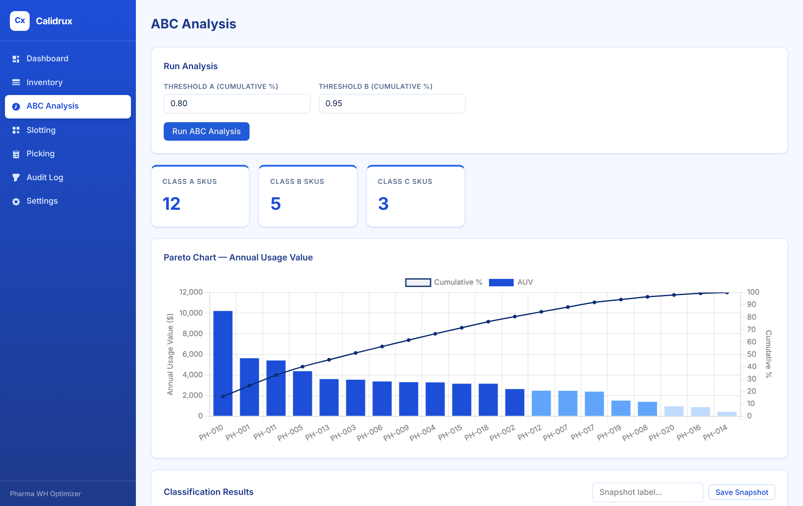

# Calidrux — Pharmaceutical Warehouse Optimizer

[](https://github.com/JijnasuRout/calidrux/actions/workflows/ci.yml)


Calidrux is an offline Windows desktop app that applies industrial engineering and
operations research methods to pharmaceutical warehouse operations. It tracks
inventory by batch and expiry, classifies SKUs with ABC analysis, recommends
storage locations with a constraint-aware optimizer, and plans shorter picking routes.



## Features

| Module | What it does | Method |
|---|---|---|
| **Inventory** | Products, batches/lots, locations; receive, transfer, adjust; CSV import; expiry alerts at 30/60/90 days | FEFO (first-expired, first-out), cold-chain zone checks |
| **ABC Analysis** | Classifies SKUs by annual usage value, Pareto chart, saved snapshots | Pareto / ABC classification (pandas) |
| **Slotting** | Recommends which location each SKU should occupy, with accept/reject workflow | Assignment model in Google OR-Tools with pharma hard constraints (cold-chain, quarantine, weight limits) |
| **Picking** | Builds pick lists and orders the stops | FEFO batch allocation + travelling-salesman routing (OR-Tools), compared against an aisle-by-aisle baseline |
| **Audit Log** | Append-only record of every change | Supports GDP-style traceability |

Everything runs locally: data lives in a SQLite database on the user's machine, and
no internet connection is needed.

## Architecture

```
pywebview window (Edge WebView2)
        │
        ▼
FastAPI + uvicorn  ── /api/...  ──►  services/  (inventory, audit)
  serves static SPA                  optimization/  (abc, slotting, picking)
  (HTML/CSS/JS + Chart.js)           db/  (SQLAlchemy models → SQLite)
```

| Layer | Tech |
|---|---|
| UI | HTML/CSS/JavaScript single-page app, Chart.js |
| Desktop shell | pywebview (uses the OS's built-in WebView2) |
| API | FastAPI, uvicorn |
| Optimization | Google OR-Tools, pandas |
| Data | SQLAlchemy 2, SQLite, Alembic |
| Packaging | PyInstaller, Inno Setup |

## Quick start (from source)

Requires Python 3.11+.

```powershell
git clone https://github.com/JijnasuRout/calidrux.git
cd calidrux
python -m venv .venv
.venv\Scripts\activate          # macOS/Linux: source .venv/bin/activate
pip install -e ".[dev]"
calidrux
```

The app opens in its own window and loads sample data (20 SKUs, 60 locations) on first launch.
To re-seed manually: `python -m calidrux.seed`.

If pywebview isn't available, Calidrux falls back to opening `http://127.0.0.1:8765` in your browser.

## Tests

```powershell
pytest
```

Tests cover ABC classification, slotting constraints, picking routes, and an end-to-end
pass through the HTTP API with seeded data.

## Build a Windows installer

```powershell
pip install -e ".[build]"
python installer\generate_icon.py
.\scripts\build_installer.ps1              # setup wizard (needs Inno Setup)
.\scripts\build_installer.ps1 -PortableOnly  # portable zip only
```

| Output | Path |
|---|---|
| Standalone app | `dist\Calidrux\Calidrux.exe` |
| Setup wizard | `dist\installer\Calidrux-Setup-0.1.0.exe` |
| Portable zip | `dist\installer\Calidrux-Portable-0.1.0.zip` |

## Data location

SQLite database and settings are stored in `%APPDATA%\Calidrux\` on Windows
(`~/.calidrux/Calidrux/` elsewhere). Back up from **Settings → Backup Database**.

## Roadmap

Calidrux is the warehouse layer of a larger end-to-end pharmaceutical supply chain
optimization project, which will also cover manufacturing scheduling and hospital
delivery routing. Next steps for the warehouse module:

- Order batching for multi-order picking
- Correlated (affinity-based) slotting from co-pick history
- Multi-criteria ABC (criticality, expiry risk, lead time)
- ABC-driven cycle-count scheduling

## Author

**Jijnasu Prakash Rout** — Industrial Engineering, Purdue University
[LinkedIn](https://www.linkedin.com/in/jijnasu-rout-30b6b7358)

## License

[MIT](LICENSE)
