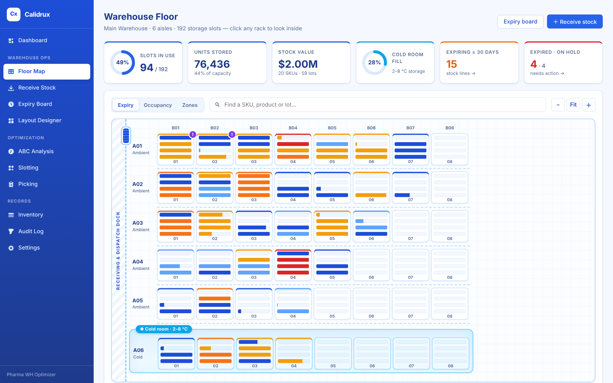
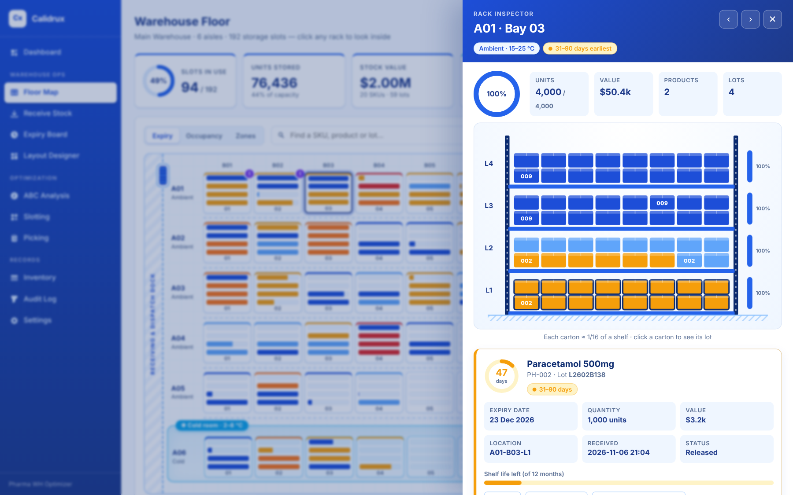
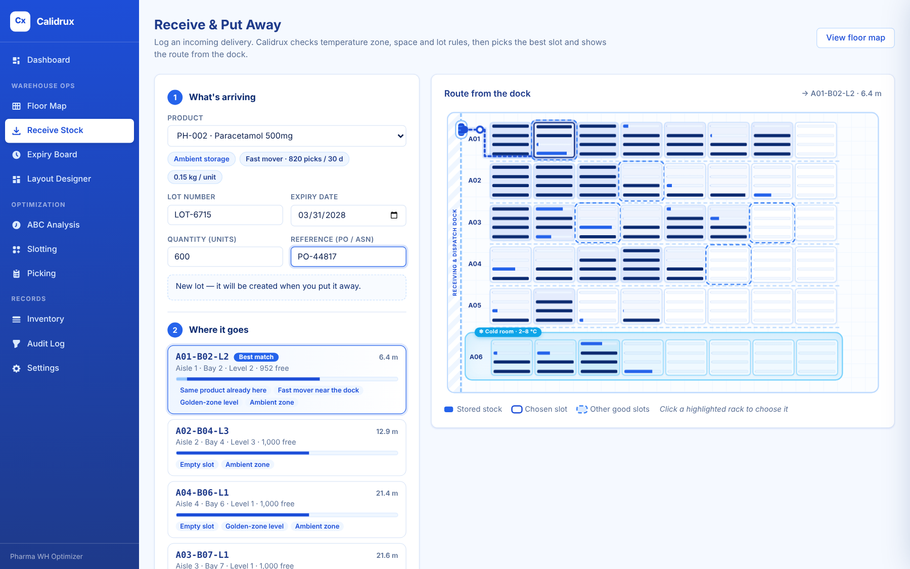
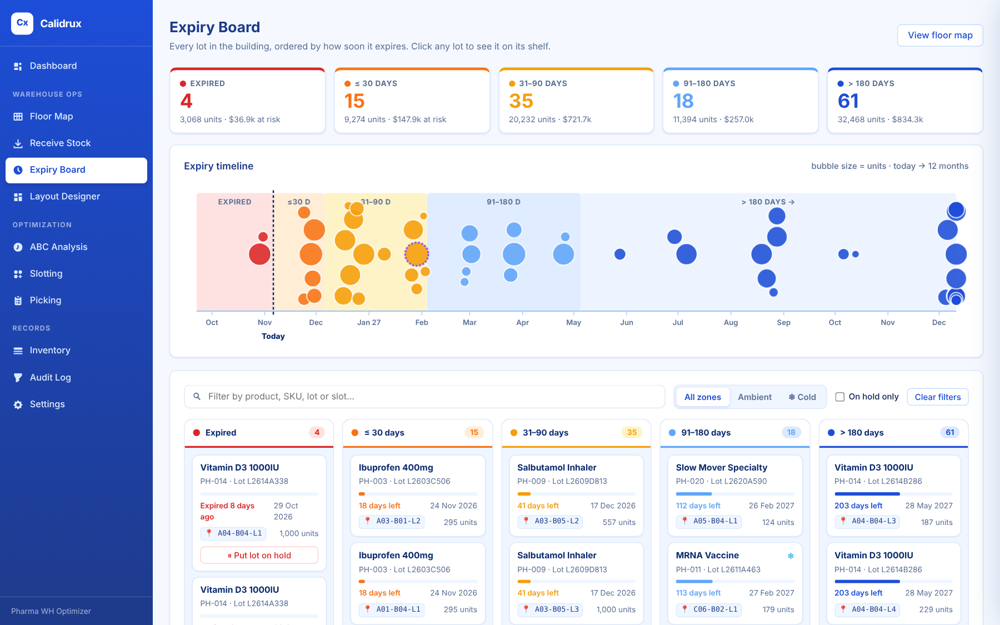
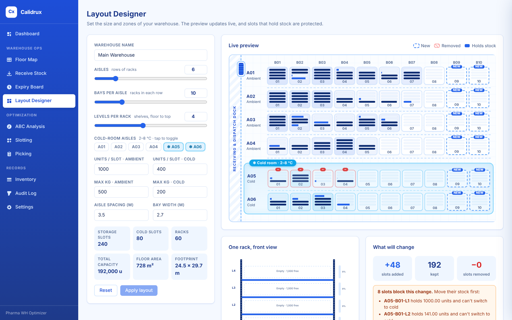

# Calidrux — Pharmaceutical Warehouse Optimizer

[](https://github.com/JijnasuRout/calidrux/actions/workflows/ci.yml)


Calidrux is an offline Windows desktop app that applies industrial engineering and
operations research methods to pharmaceutical warehouse operations. It shows where
every unit of medicine sits on an interactive floor map, tracks every lot by expiry,
guides put-away into the right temperature zone, classifies SKUs with ABC analysis,
recommends storage locations with a constraint-aware optimizer, and plans shorter
picking routes.



## Warehouse Operations

**Floor map** — a live top-down plan of every aisle and rack. Each rack shows its shelf
levels as bars, coloured by the earliest expiry on that shelf (or by fill level or zone).
Search any SKU, product or lot and the matching racks light up. The 2–8 °C cold room is
drawn as its own zone.

**Rack inspector** — click a rack and a front-view diagram slides in: uprights, beams and
cartons that drop onto each shelf, sized by quantity and coloured by expiry. Click a carton
to see the lot's expiry countdown, quantity, value, location and receipt date, then move
it, put the lot on hold, or find it everywhere.



**Receive & put away** — log a delivery (product, lot, expiry, quantity, PO). Calidrux ranks
the slots that can take it — right temperature zone, enough space, no mixing of different
products in one slot, same-lot consolidation first, fast movers near the dock — and
animates the route from the dock door to the chosen rack.



**Expiry board** — every lot bucketed as Expired / ≤30 / 31–90 / 91–180 / >180 days with
units and value at risk, a 12-month timeline (bubble size = units) and a board of cards.
Click anything to jump to its shelf; put expired lots on hold in one click.



**Layout designer** — set aisles, bays, levels, which aisles are cold rooms, slot capacity,
weight limits and spacing. The preview updates live, showing new racks and racks that would
be removed. Slots that still hold stock can't be removed or switched between cold and
ambient; retired slots are kept for history, never deleted.



## All modules

| Module | What it does | Method |
|---|---|---|
| **Warehouse Ops** | Floor map, rack inspector, receiving & put-away, expiry board, layout designer | Rule-based put-away scoring (zone, capacity, no-mixing, consolidation, velocity × distance); FEFO expiry buckets |
| **Inventory** | Products, batches/lots, locations; receive, transfer, adjust; CSV import; expiry alerts at 30/60/90 days | FEFO (first-expired, first-out), cold-chain zone checks |
| **ABC Analysis** | Classifies SKUs by annual usage value, Pareto chart, saved snapshots | Pareto / ABC classification (pandas) |
| **Slotting** | Recommends which location each SKU should occupy, with accept/reject workflow | Assignment model in Google OR-Tools with pharma hard constraints (cold-chain, quarantine, weight limits) |
| **Picking** | Builds pick lists and orders the stops | FEFO batch allocation + travelling-salesman routing (OR-Tools), compared against an aisle-by-aisle baseline |
| **Audit Log** | Append-only record of every change | Supports GDP-style traceability |

Everything runs locally: data lives in a SQLite database on the user's machine, and
no internet connection is needed.

## Architecture

```
pywebview window (Edge WebView2)
        │
        ▼
FastAPI + uvicorn  ── /api/...  ──►  warehouse/  (layout, floor map, put-away, expiry)
                                     services/  (inventory, audit)
  serves static SPA                  optimization/  (abc, slotting, picking)
  (HTML/CSS/JS + Chart.js)           db/  (SQLAlchemy models → SQLite)
```

| Layer | Tech |
|---|---|
| UI | HTML/CSS/JavaScript single-page app, Chart.js |
| Desktop shell | pywebview (uses the OS's built-in WebView2) |
| API | FastAPI, uvicorn |
| Optimization | Google OR-Tools, pandas |
| Data | SQLAlchemy 2, SQLite, Alembic |
| Packaging | PyInstaller, Inno Setup |

## Quick start (from source)

Requires Python 3.11+.

```powershell
git clone https://github.com/JijnasuRout/calidrux.git
cd calidrux
python -m venv .venv
.venv\Scripts\activate          # macOS/Linux: source .venv/bin/activate
pip install -e ".[dev]"
calidrux
```

The app opens in its own window and loads sample data on first launch: 20 SKUs, about 60 lots,
and a 6-aisle × 8-bay × 4-level warehouse (192 slots) with a cold room.
To re-seed manually: `python -m calidrux.seed`.

If pywebview isn't available, Calidrux falls back to opening `http://127.0.0.1:8765` in your browser.

## Tests

```powershell
pytest
```

Tests cover ABC classification, slotting constraints, picking routes, the warehouse rules
(temperature zones, capacity, no product mixing, lot/expiry checks, holds, moves, layout
changes that would strand stock) and upgrading a database from an earlier version.

## Build a Windows installer

```powershell
pip install -e ".[build]"
python installer\generate_icon.py
.\scripts\build_installer.ps1              # setup wizard (needs Inno Setup)
.\scripts\build_installer.ps1 -PortableOnly  # portable zip only
```

| Output | Path |
|---|---|
| Standalone app | `dist\Calidrux\Calidrux.exe` |
| Setup wizard | `dist\installer\Calidrux-Setup-0.1.0.exe` |
| Portable zip | `dist\installer\Calidrux-Portable-0.1.0.zip` |

## Data location

SQLite database and settings are stored in `%APPDATA%\Calidrux\` on Windows
(`~/.calidrux/Calidrux/` elsewhere), or in `CALIDRUX_DATA_DIR` if that is set.
Back up from **Settings → Backup Database**. Databases from earlier versions are
upgraded automatically on launch.

## Roadmap

Calidrux is the warehouse layer of a larger end-to-end pharmaceutical supply chain
optimization project, which will also cover manufacturing scheduling and hospital
delivery routing. Next steps for the warehouse module:

- Order batching for multi-order picking
- Correlated (affinity-based) slotting from co-pick history
- Multi-criteria ABC (criticality, expiry risk, lead time)
- ABC-driven cycle-count scheduling

## Author

**Jijnasu Prakash Rout** — Industrial Engineering, Purdue University
[LinkedIn](https://www.linkedin.com/in/jijnasu-rout-30b6b7358)

## License

[MIT](LICENSE)
