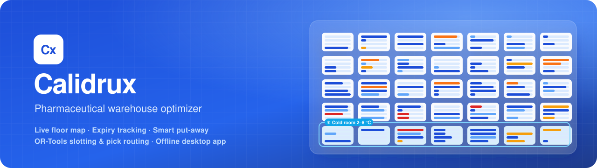
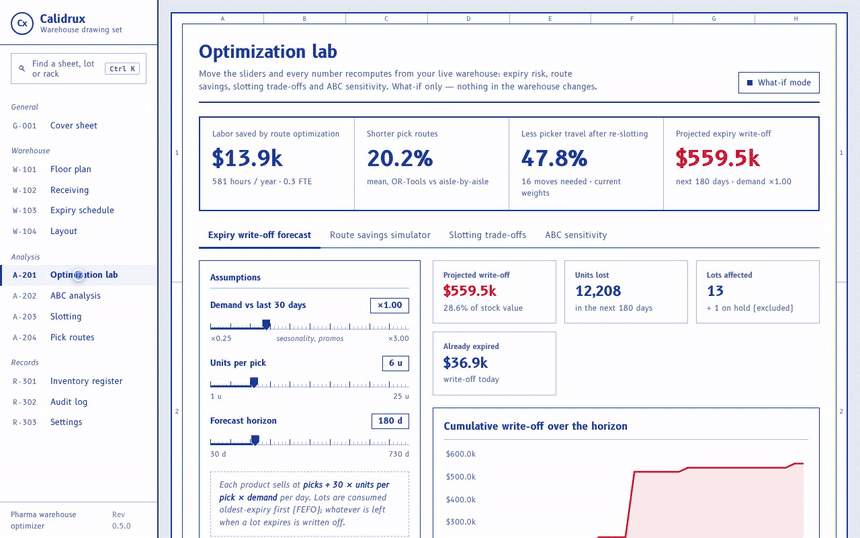
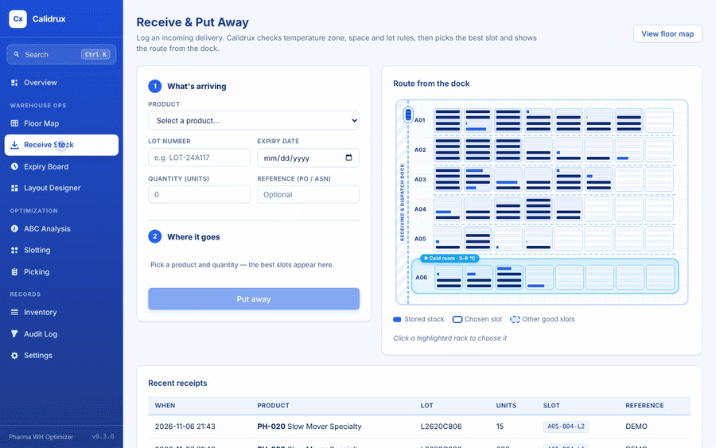
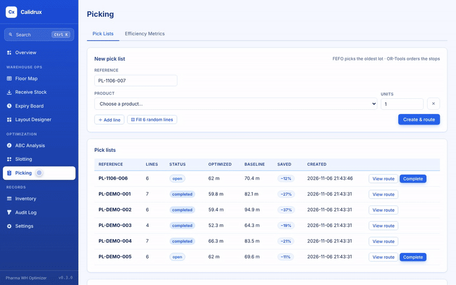
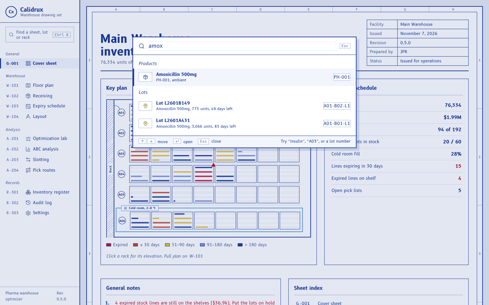
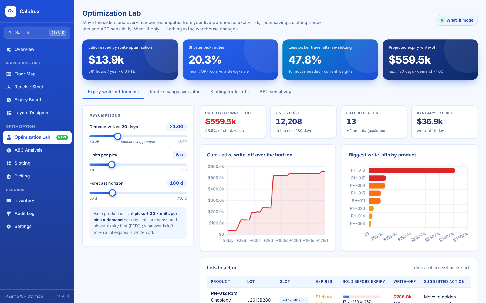
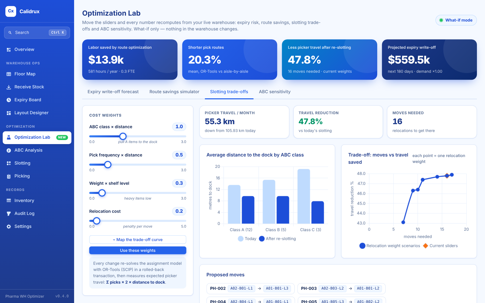

<p align="center">
  
</p>

<p align="center">
  <a href="https://github.com/JijnasuRout/Calidrux/actions/workflows/ci.yml"></a>
  
  
  
  
  <a href="LICENSE"></a>
</p>

<p align="center">
  <b>See every unit of medicine in your warehouse: where it is, how fresh it is,<br>
  and the fastest way to put it away and pick it.</b>
</p>

<p align="center">
  <a href="#quick-start">Quick start</a> ·
  <a href="docs/USER_GUIDE.md">User guide</a> ·
  <a href="docs/METHODS.md">Engineering notes</a> ·
  <a href="docs/ARCHITECTURE.md">Architecture</a> ·
  <a href="CHANGELOG.md">Changelog</a>
</p>

<p align="center">
  
</p>

## Optimization Lab — move a slider, see the impact

Every number recomputes from the live warehouse as you drag. It's what-if only, so nothing
in the warehouse changes.

<p align="center"></p>

| Panel | Sliders | What you get |
|---|---|---|
| **Expiry write-off forecast** | demand ×, units per pick, horizon | FEFO depletion simulation per lot, projected write-off in $ and units, lots to act on with a suggested action |
| **Route savings simulator** | orders, lines per order · orders/day, walking speed, labor $/h, days/year | Monte Carlo of up to 400 orders, each routed by OR-Tools vs aisle-by-aisle: savings distribution, scatter, and **annual labor $, hours, km and FTEs saved** |
| **Slotting trade-offs** | four cost weights | Re-solves the assignment model live and measures picker travel before vs after; sweeps relocation cost to map the **moves vs savings trade-off curve** |
| **ABC sensitivity** | A and B cut-offs | Live Pareto chart and class counts, and which SKUs change class |

With the sample warehouse, optimized routes are about **20% shorter** for 8-stop orders and
about **29% shorter** for 16-stop orders. At 1,500 orders a day that is roughly **$72k a year**
of picker time. Re-slotting cuts expected picker travel by about **46–48%**, needing 10–16
relocations depending on the relocation cost. The models are explained in
[Engineering notes §11–13](docs/METHODS.md#11-expiry-write-off-forecast).

## Why Calidrux

A pharmaceutical warehouse isn't just shelves of boxes. Every lot has an **expiry date**,
some products must stay at **2–8 °C**, suspect lots go on **quality hold**, and every move
has to be **traceable**. Calidrux is a desktop warehouse system built around those rules,
with industrial engineering methods doing the planning:

- a **live floor map** that shows what is on every shelf and how close it is to expiry,
- **put-away suggestions** that respect temperature zones, capacity and lot rules,
- **FEFO picking** with **routes optimized by OR-Tools**, measured against a naive baseline,
- **ABC classification** and **slotting optimization** to keep fast movers close to the dock.

It runs fully offline on a Windows laptop, and one click loads a realistic sample warehouse.

## Highlights

<table>
  <tr>
    <td width="50%" valign="top">
      <h3>🗺️ Live floor map</h3>
      Every aisle, rack and shelf level, coloured by the earliest expiry on it (or by fill
      level or temperature zone). Type a SKU, product or lot and the matching racks light up.
    </td>
    <td width="50%" valign="top">
      <h3>📦 Rack inspector</h3>
      Click a rack and a front-view diagram slides in, with cartons dropping onto each shelf.
      Click a carton to see the lot's expiry countdown, then move it, hold it, or find it
      everywhere.
    </td>
  </tr>
  <tr>
    <td valign="top">
      <h3>⤓ Smart receiving</h3>
      Calidrux ranks the slots that can take a delivery (right zone, enough space, no product
      mixing, same-lot consolidation, fast movers near the dock) and animates the route from
      the dock door.
    </td>
    <td valign="top">
      <h3>⏱️ Expiry board</h3>
      Every lot grouped as expired, ≤ 30, 31–90, 91–180 and 180+ days, with value at risk, a
      12-month timeline and one-click quality holds.
    </td>
  </tr>
  <tr>
    <td valign="top">
      <h3>🧭 Optimized picking</h3>
      FEFO lot selection plus a travelling-salesman route from OR-Tools, drawn on the floor
      plan next to the aisle-by-aisle route. Sample routes are typically 15–30% shorter.
    </td>
    <td valign="top">
      <h3>📐 Layout designer</h3>
      Set aisles, bays, levels and cold rooms with a live preview. Changes that would strand
      stock are blocked, and retired slots are kept for audit history.
    </td>
  </tr>
  <tr>
    <td valign="top">
      <h3>📊 ABC & slotting</h3>
      Pareto classification by usage value, and an assignment model (OR-Tools SCIP) that
      places each product in its lowest-cost slot within cold-chain, quarantine and weight
      limits.
    </td>
    <td valign="top">
      <h3>⚗️ Optimization Lab</h3>
      Sliders drive live what-if analyses: expiry write-off forecast, Monte Carlo route
      ROI in $/year, a slotting trade-off curve and ABC sensitivity.
    </td>
  </tr>
  <tr>
    <td valign="top" colspan="2">
      <h3>✨ Built to feel smooth</h3>
      Overview dashboard, <kbd>Ctrl</kbd>+<kbd>K</kbd> command palette, view transitions,
      sliding indicators, animated charts and an append-only audit trail on every change.
    </td>
  </tr>
</table>

## See it in action

**Receiving:** pick the product and quantity, get ranked slots with reasons, and watch the
delivery travel from the dock to its shelf.

<p align="center"></p>

**Pick routing:** FEFO chooses the lots, OR-Tools orders the stops, and the dashed orange
line is the naive aisle-by-aisle route it beats.

<p align="center"></p>

<details>
<summary><b>More screenshots</b></summary>
<br>
<table>
  <tr>
    <td><p align="center">Overview</p></td>
    <td><p align="center">Floor map</p></td>
  </tr>
  <tr>
    <td><p align="center">Rack inspector</p></td>
    <td><p align="center">Expiry board</p></td>
  </tr>
  <tr>
    <td><p align="center">Layout designer</p></td>
    <td><p align="center">Command palette (Ctrl+K)</p></td>
  </tr>
  <tr>
    <td><p align="center">Pick route</p></td>
    <td><p align="center">ABC analysis</p></td>
  </tr>
  <tr>
    <td><p align="center">Lab · expiry write-off forecast</p></td>
    <td><p align="center">Lab · slotting trade-off curve</p></td>
  </tr>
</table>
</details>

## How it works

| Problem | Method | Details |
|---|---|---|
| Which SKUs matter most? | ABC / Pareto on usage value $f_i \cdot c_i$ | [Notes §2](docs/METHODS.md#2-abc-classification) |
| Which lot ships first? | FEFO; expired and held lots are never picked | [Notes §3](docs/METHODS.md#3-expiry-control-fefo-and-shelf-life-buckets) |
| Where should a delivery go? | Hard rules + weighted score (velocity × distance, height, consolidation) | [Notes §4](docs/METHODS.md#4-put-away-choosing-a-slot-for-incoming-stock) |
| Where should each product live? | Linear assignment model, solved exactly with OR-Tools (SCIP) | [Notes §5](docs/METHODS.md#5-slotting-optimization-assignment-model) |
| In what order to pick? | Travelling-salesman problem, OR-Tools routing with Guided Local Search | [Notes §6](docs/METHODS.md#6-pick-routing-travelling-salesman-problem) |
| Can the layout change safely? | Grid reconciliation that blocks any change stranding stock | [Notes §7](docs/METHODS.md#7-layout-changes-that-never-strand-stock) |
| How much will expire unsold? | FEFO depletion simulation at a forecast demand rate | [Notes §11](docs/METHODS.md#11-expiry-write-off-forecast) |
| What is route optimization worth? | Monte Carlo over sampled orders → labor $/year | [Notes §12](docs/METHODS.md#12-route-savings-simulation-monte-carlo) |
| How many moves are worth making? | Parametric sweep of the slotting model | [Notes §13](docs/METHODS.md#13-slotting-trade-off-sweep) |

The full write-up, with formulas, assumptions and limitations, is in
**[docs/METHODS.md](docs/METHODS.md)**.

## Quick start

Requires **Windows 10/11** and **Python 3.11+**.

```powershell
git clone https://github.com/JijnasuRout/Calidrux.git
cd Calidrux
python -m venv .venv
.venv\Scripts\python -m pip install -e .
.venv\Scripts\calidrux
```

The app opens in its own window and loads a sample warehouse on first launch: 20 SKUs,
about 60 lots, and 6 aisles × 8 bays × 4 levels (192 slots) including a cold room. If the
window can't open, Calidrux falls back to `http://127.0.0.1:8765` in your browser.

<details>
<summary><b>macOS / Linux, tests, and building a Windows installer</b></summary>

```bash
python3 -m venv .venv && source .venv/bin/activate
pip install -e ".[dev]"
calidrux          # run the app
pytest            # 37 tests, about 3 seconds
```

Build a Windows app and installer:

```powershell
pip install -e ".[build]"
python installer\generate_icon.py
.\scripts\build_installer.ps1               # setup wizard (needs Inno Setup)
.\scripts\build_installer.ps1 -PortableOnly # portable zip only
```

| Output | Path |
|---|---|
| Standalone app | `dist\Calidrux\Calidrux.exe` |
| Setup wizard | `dist\installer\Calidrux-Setup-0.4.0.exe` |
| Portable zip | `dist\installer\Calidrux-Portable-0.4.0.zip` |

Data is stored in `%APPDATA%\Calidrux\` (or `~/.calidrux/Calidrux/`, or `CALIDRUX_DATA_DIR`
if set). Databases from earlier versions are upgraded automatically.
</details>

## Tech stack

| Layer | Technology |
|---|---|
| Optimization | Google OR-Tools (SCIP MIP for slotting, RoutingModel for TSP), pandas |
| Backend | Python 3.11+, FastAPI, uvicorn, SQLAlchemy 2, SQLite |
| Interface | HTML, CSS, JavaScript (no framework, no build step), Chart.js |
| Desktop | pywebview with Edge WebView2, PyInstaller, Inno Setup |
| Quality | pytest (37 tests), GitHub Actions on Windows and Linux |

More detail, including diagrams of the components, data model and request flow, is in
[docs/ARCHITECTURE.md](docs/ARCHITECTURE.md).

## Roadmap

- [ ] GS1 barcode scanning at receiving and picking
- [ ] User accounts with roles and electronic sign-off for holds and releases
- [ ] Serial-number (unit-level) tracking for DSCSA / EU FMD
- [ ] Order batching and correlated (affinity) slotting
- [ ] Aisle-aware travel distances instead of straight lines

Calidrux is the warehouse layer of a larger end-to-end pharmaceutical supply chain project,
which will also cover manufacturing scheduling and hospital delivery routing.

## Author

**Jijnasu Prakash Rout** — Industrial Engineering, Purdue University ·
[LinkedIn](https://www.linkedin.com/in/jijnasu-rout-30b6b7358)

## License

[MIT](LICENSE)
