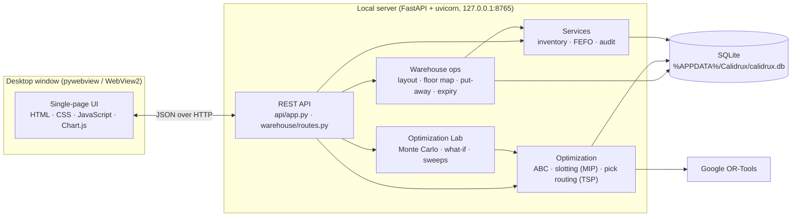
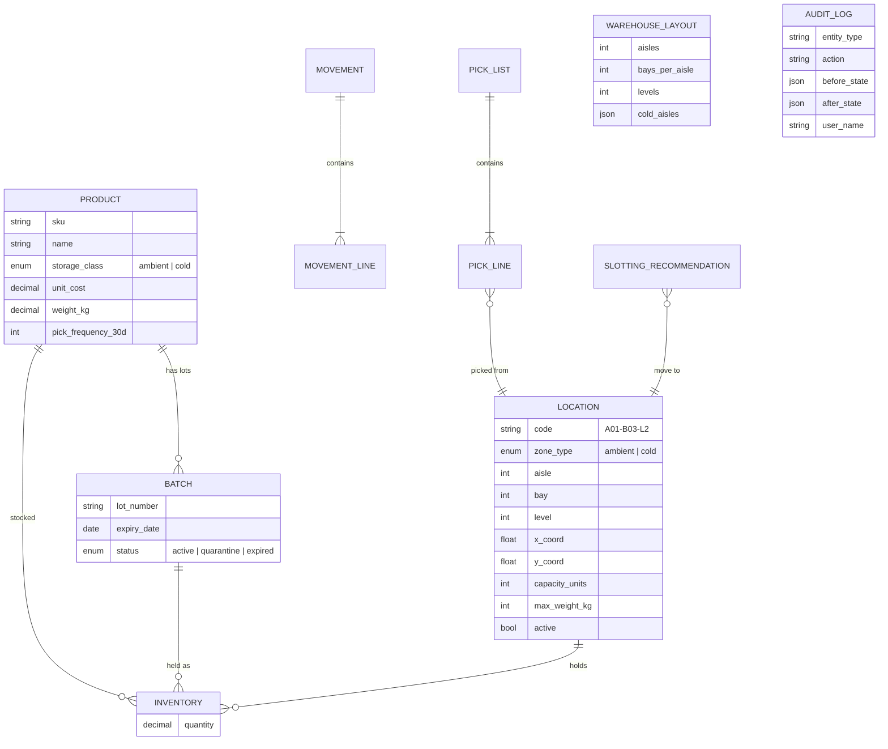
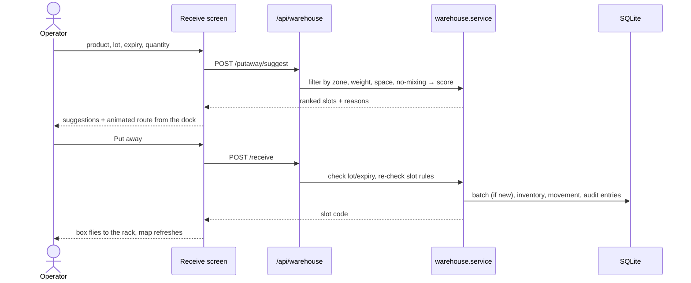

# Architecture

Calidrux is a single-user desktop app. A local FastAPI server does all the work, and a
native window (pywebview, using the Edge WebView2 engine built into Windows) shows the
interface. Nothing leaves the machine: data lives in one SQLite file.



## Source layout

```
src/calidrux/
├── main.py                 # starts the server thread and opens the window
├── config.py               # settings + data folder (CALIDRUX_DATA_DIR overrides it)
├── seed.py                 # sample warehouse, stock and pick history
├── api/
│   ├── app.py              # REST routes for inventory, ABC, slotting, picking, audit, settings
│   └── static/             # the UI (no build step)
│       ├── index.html
│       ├── style.css       # base theme (blue & white)
│       ├── app.js          # original screens + view router
│       ├── warehouse.js    # floor map renderer + rack inspector
│       ├── warehouse-ops.js# receive & put-away, expiry board, layout designer
│       ├── overview.js     # Overview dashboard
│       ├── palette.js      # Ctrl+K command palette
│       ├── enhance.js      # picking route map, dropdown pickers, slotting/audit upgrades
│       ├── lab.js/.css     # Optimization Lab: sliders, live what-if charts
│       ├── motion.js/.css  # transitions, sliding indicators, toasts, chart defaults
│       └── warehouse.css
├── analytics/
│   └── lab.py              # Optimization Lab: route Monte Carlo, slotting what-if & sweep (/api/lab/*)
├── warehouse/
│   ├── layout.py           # layout spec, preview, apply (never strands stock)
│   ├── service.py          # floor snapshot, rack detail, expiry board, put-away, moves
│   └── routes.py           # /api/warehouse/*
├── optimization/
│   ├── abc.py              # Pareto / ABC classification
│   ├── slotting.py         # assignment model (OR-Tools SCIP)
│   └── picking.py          # FEFO allocation + TSP routing (OR-Tools RoutingModel)
├── services/
│   ├── inventory.py        # CRUD, receive/transfer/adjust, FEFO, cold-chain checks
│   └── audit.py            # append-only audit log
└── db/
    ├── session.py          # engine, sessions, in-place schema upgrades
    └── models/             # SQLAlchemy models
```

## Data model



## A receipt, end to end



## Design decisions

| Decision | Why |
|---|---|
| Local web server + native window | One codebase gives a modern UI and a real desktop app. WebView2 ships with Windows, so no browser engine is bundled (about 180 MB installed, versus about 400 MB for the earlier Qt version). |
| SQLite, offline | Zero setup, a single file to back up, and no network dependency on a warehouse floor. |
| Plain JavaScript, no build step | Anyone can read and change the UI; nothing to compile. |
| OR-Tools | Industrial-grade, free solvers for both the assignment model (MIP) and routing (TSP). |
| Slots are deactivated, not deleted | Movement and pick history keep valid references. |
| In-place schema upgrades | Users keep their data across versions without a migration step. |
| One motion layer (`motion.js`) | Every screen gets the same transitions without duplicating animation code. |

## Testing

`pytest` runs 37 tests in about 3 seconds:

- **Unit:** ABC classification, slotting constraints, the TSP solver.
- **End to end through HTTP:** every read endpoint, ABC, slotting, the pick lifecycle,
  and FEFO never picking expired lots.
- **Warehouse rules:** temperature zones, capacity, no product mixing, lot/expiry checks,
  holds, moves, layout changes blocked by stock, and database upgrades from earlier
  versions.
- **Lab:** reproducible simulations, optimized routes never longer than the baseline, and
  what-if runs that leave data and settings untouched.

GitHub Actions runs the suite on Windows and Linux with Python 3.11 and 3.12.
