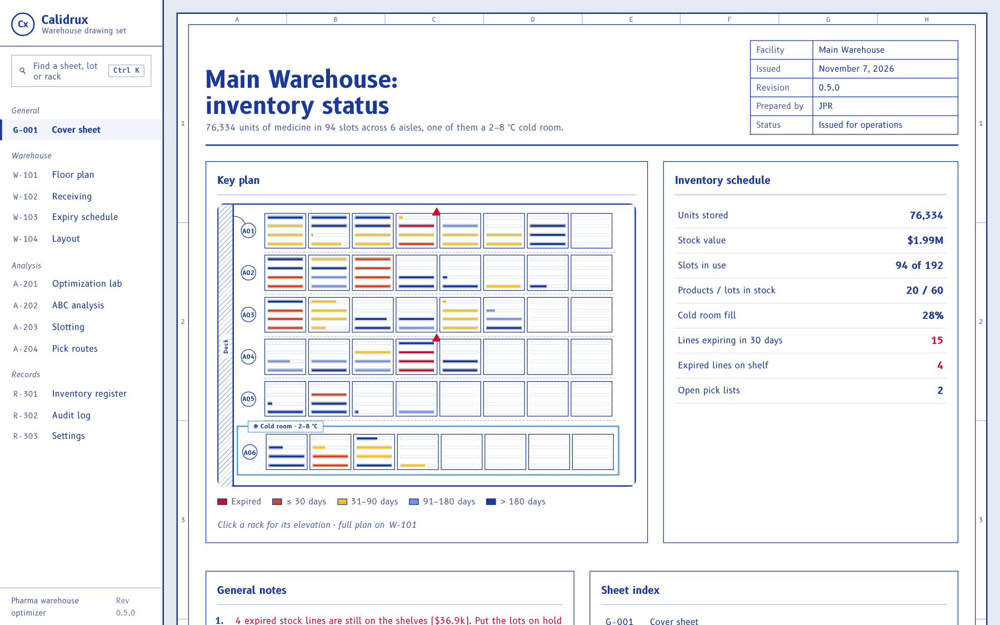
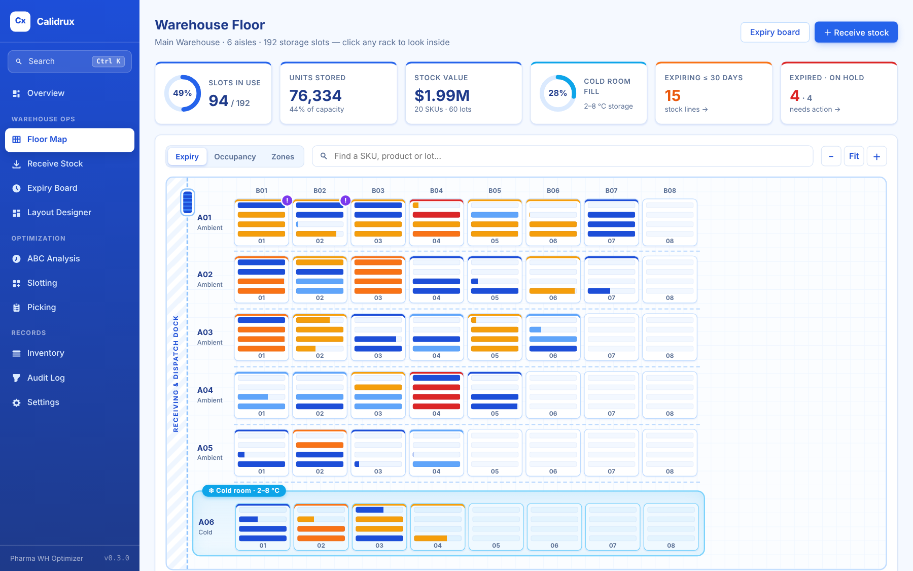
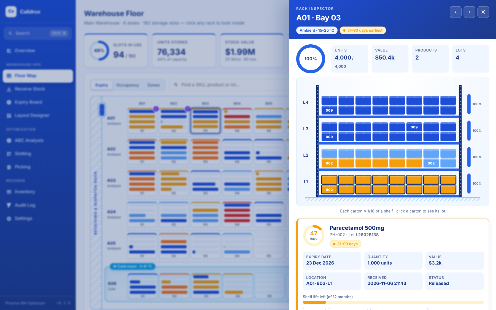
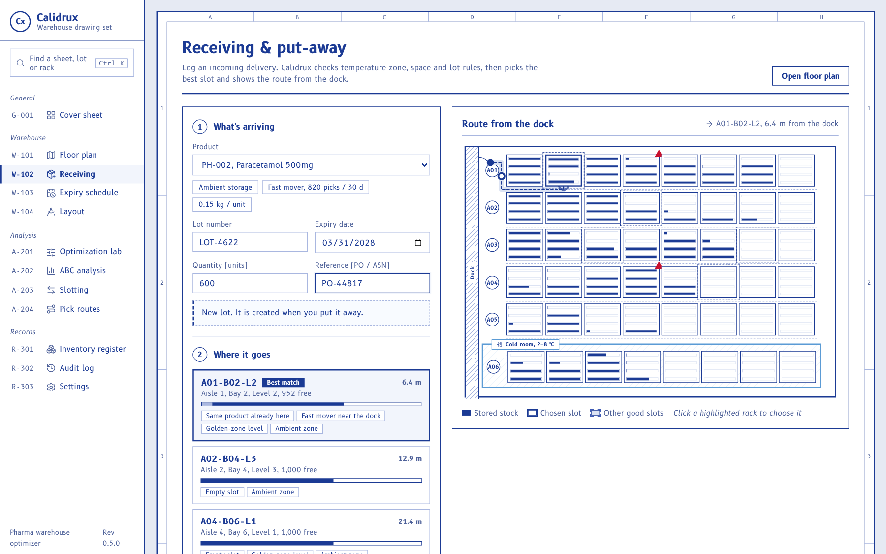
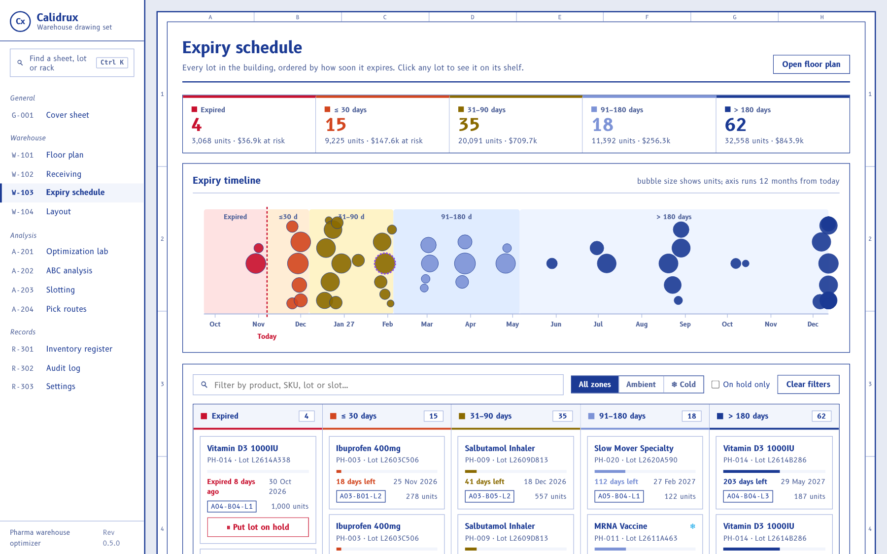
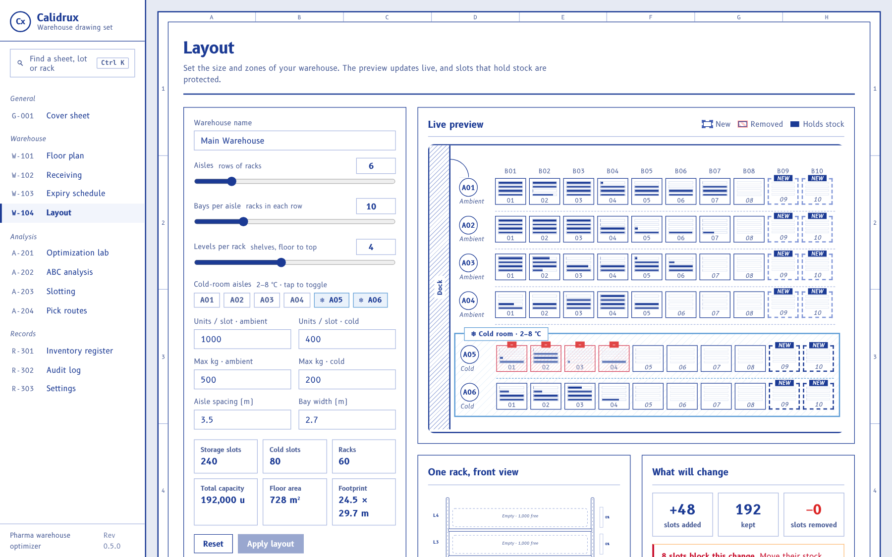
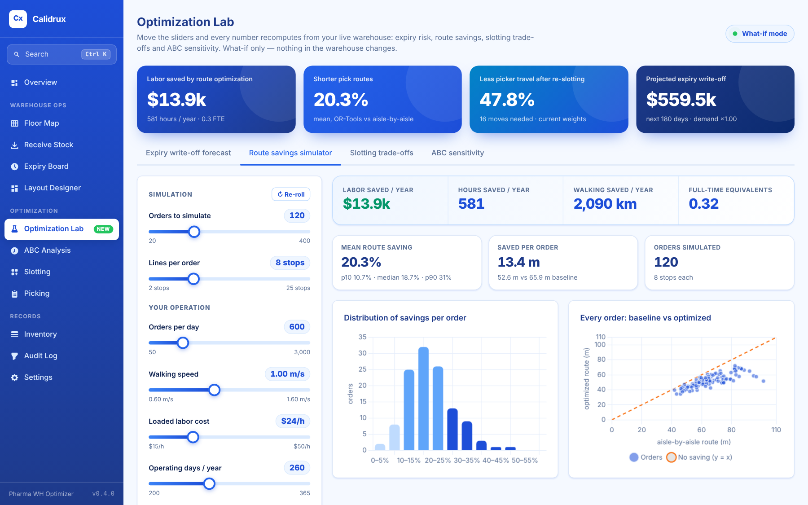
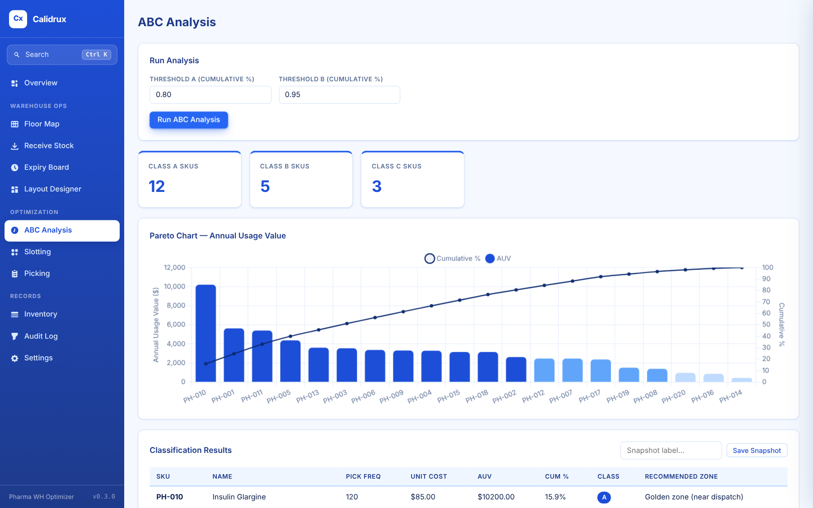
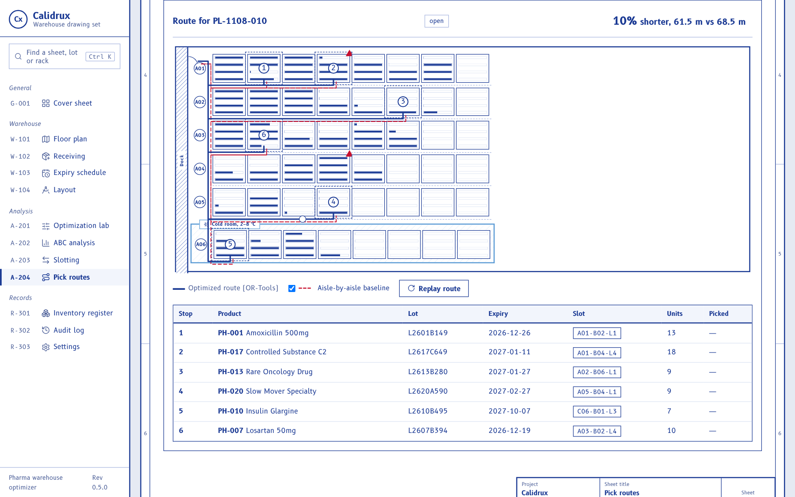

# User guide

A tour of every screen. On first launch Calidrux loads a sample warehouse, so everything
below works straight away.

> **Tip:** press <kbd>Ctrl</kbd> + <kbd>K</kbd> (or <kbd>/</kbd>) anywhere to search
> screens, products, lots and racks.

## Overview

The home screen: units stored, stock value, slot and cold-room use, what expires soon,
open picks, a live mini-map of the floor, the most urgent lots and recent activity. Every
tile is clickable and takes you to the detail behind it.

## Floor Map

A top-down plan of the warehouse.

- Each tile is a **rack**, and the bars inside it are its **shelf levels**.
- **Expiry** mode colours each shelf by its most urgent lot: red = expired,
  orange = ≤ 30 days, amber = 31–90, light blue = 91–180, blue = later.
- **Occupancy** mode shows how full each shelf is; **Zones** highlights the cold room.
- Type in the search box to find a SKU, product name or lot. The matching racks pulse and
  everything else fades.
- Use <kbd>−</kbd> / <kbd>Fit</kbd> / <kbd>＋</kbd> to zoom.

### Rack inspector

Click any rack to open its front view. Cartons drop onto each shelf, sized by quantity
and coloured by expiry. Click a carton to see the lot: an expiry countdown, quantity,
value, slot and the date it was received. From there you can:

- **Move** it to another slot (only slots that pass the zone, space and no-mixing rules are offered),
- **Put the lot on hold**, or release it, and
- **Find this lot everywhere** on the map.

Use <kbd>←</kbd> <kbd>→</kbd> to step through racks and <kbd>Esc</kbd> to close.

## Receive Stock

1. Choose the product. Cold-chain products are flagged.
2. Enter the lot number, expiry date and quantity. If the lot already exists, its expiry
   is filled in and locked.
3. Calidrux ranks the slots that can take the delivery and explains each choice. The
   map shows the route from the dock door.
4. Pick a suggestion, or click a highlighted rack, then **Put away**.

## Expiry Board

Every lot in the building, grouped by how soon it expires.

- The tiles at the top show lines, units and value at risk. Click one to focus on it.
- The timeline shows every lot on a 12-month axis; bubble size is quantity.
- The board shows a card per stock line. Click a card to open its shelf.
  Expired lots get a one-click **Put lot on hold** button.
- Filter by text, zone, or "on hold only".

## Layout Designer

Set the size of the warehouse: aisles, bays per aisle, levels, which aisles are cold
rooms, slot capacity, weight limits and spacing. The preview marks **new** racks and racks
that would be **removed**. If a removed or re-zoned slot still holds stock, the change is
blocked and the panel lists the slots to clear first.

## Optimization Lab

Sliders drive four live what-if analyses. The four cards at the top summarise the impact
in dollars and percentages. Nothing in the warehouse changes.

- **Expiry write-off forecast:** set demand, units per pick and horizon to see the
  projected write-off, a cumulative curve, the biggest products at risk, and lots to act
  on. Click a lot to open its shelf.
- **Route savings simulator:** simulate up to 400 orders, then enter your orders per day,
  walking speed, labor cost and operating days to get labor saved per year.
- **Slotting trade-offs:** adjust the four cost weights and the solver re-runs live.
  **Map the trade-off curve** shows moves vs savings. **Use these weights** saves them for
  the Slotting screen.
- **ABC sensitivity:** move the A and B cut-offs and watch the Pareto chart re-classify.

## ABC Analysis

Classifies every SKU by usage value (picks × unit cost) into A, B and C, with a Pareto
chart. You can change the thresholds and save snapshots.

## Slotting

Runs an OR-Tools assignment model that proposes the best slot for each product. You can
accept or reject each move, or accept all of them. Accepting moves the stock and records
it in the audit log.

## Picking

Build a pick list from product dropdowns, or use **Fill 6 random lines** for a demo.
Calidrux chooses lots by FEFO and orders the stops with a TSP solver. The route is drawn
on the floor plan next to the aisle-by-aisle baseline, with the distance saved. The
**Efficiency Metrics** tab tracks picks per hour and average savings.

## Inventory, Audit Log, Settings

- **Inventory:** products, slots, lots, stock, manual receive, transfer and adjust, and
  CSV import. IDs are chosen from dropdowns.
- **Audit Log:** every change, searchable and filterable by entity.
- **Settings:** user name for the audit trail, dock position, ABC thresholds, slotting
  weights and database backup.

## Keyboard shortcuts

| Keys | Action |
|---|---|
| <kbd>Ctrl</kbd> + <kbd>K</kbd> or <kbd>/</kbd> | Open search |
| <kbd>↑</kbd> <kbd>↓</kbd> <kbd>Enter</kbd> | Move through and open search results |
| <kbd>←</kbd> <kbd>→</kbd> | Previous / next rack in the inspector |
| <kbd>Esc</kbd> | Close search, inspector or dialogs |

## Where your data lives

`%APPDATA%\Calidrux\calidrux.db` (Windows). Back it up from **Settings → Backup
Database**. To start over with fresh sample data, close the app, rename that file and
relaunch.
